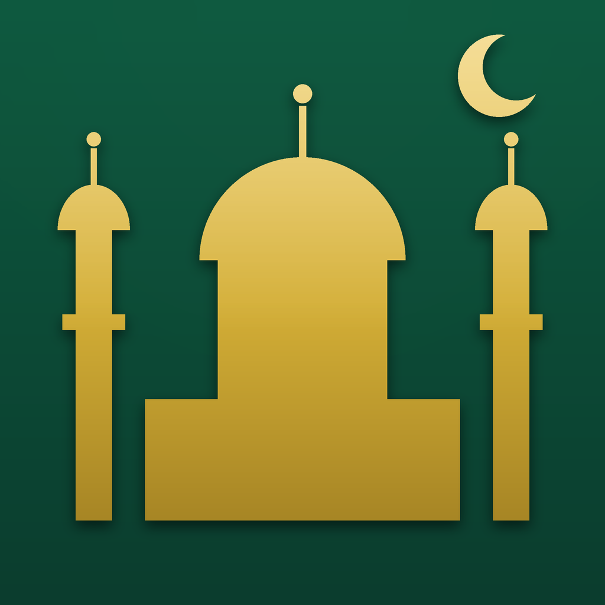
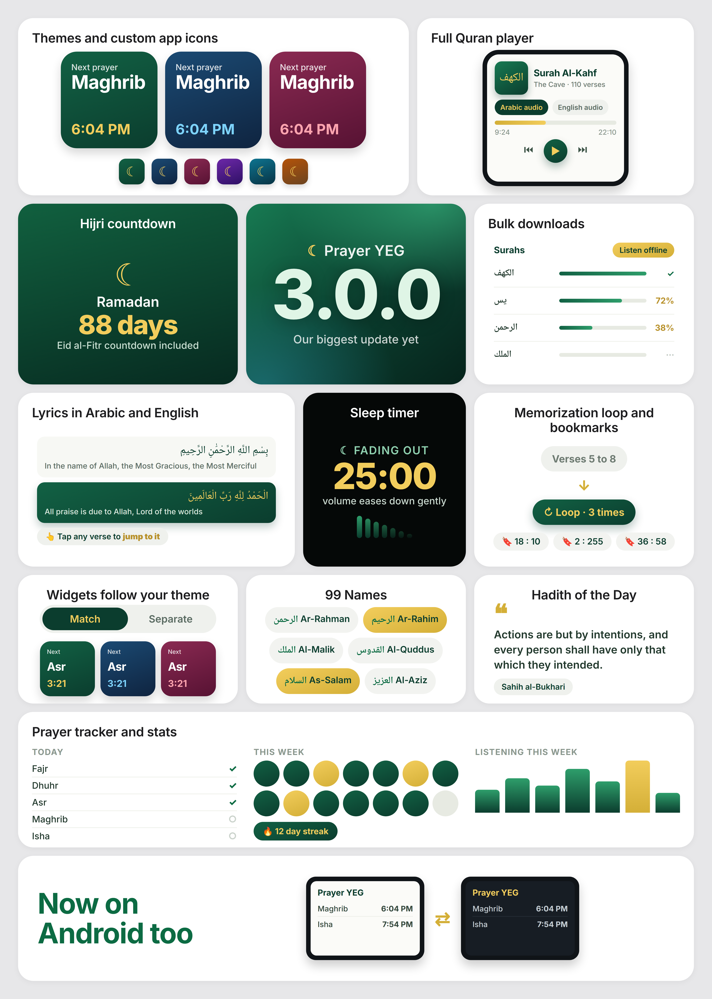
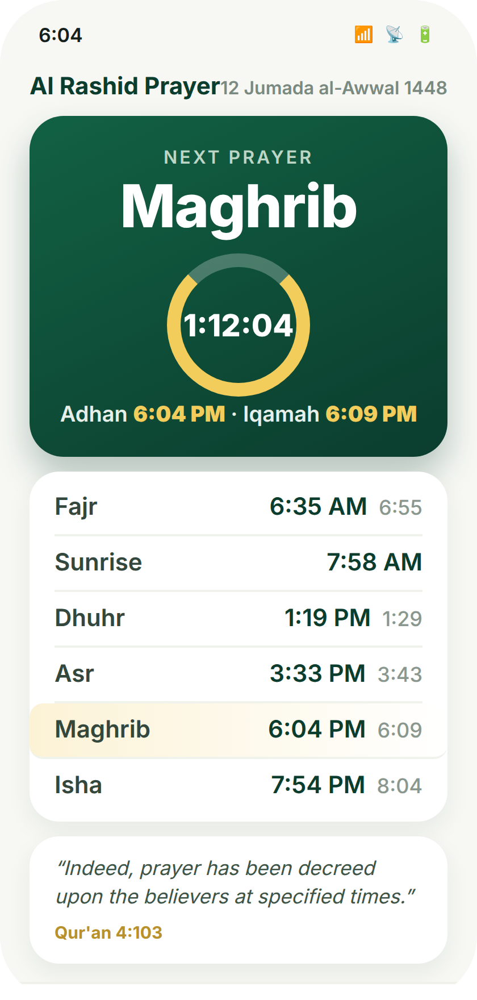
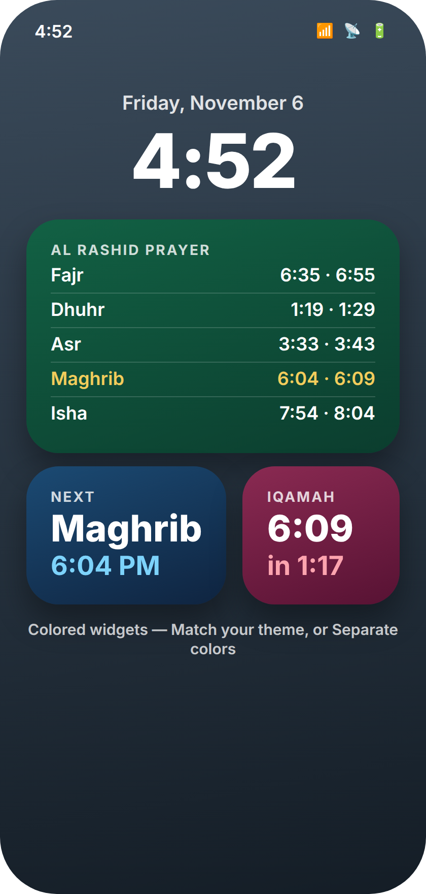
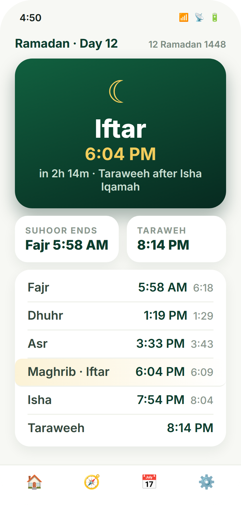
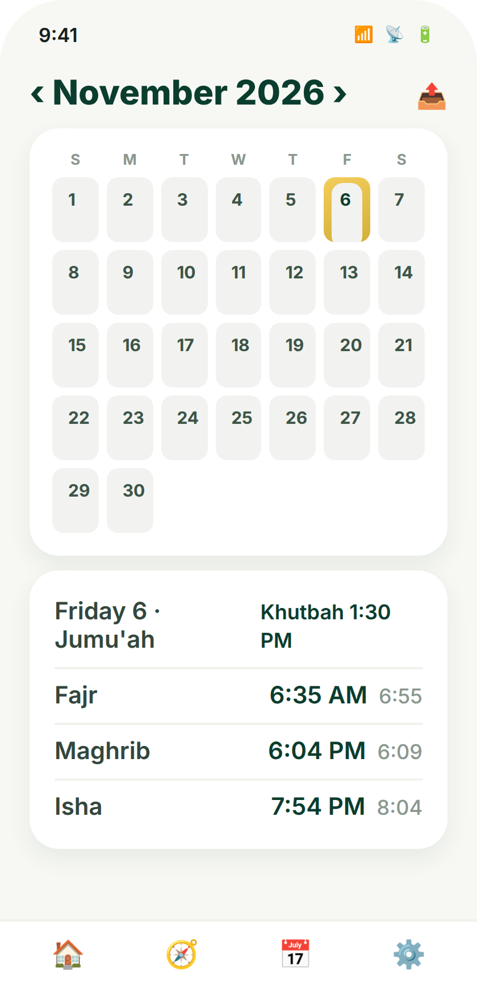
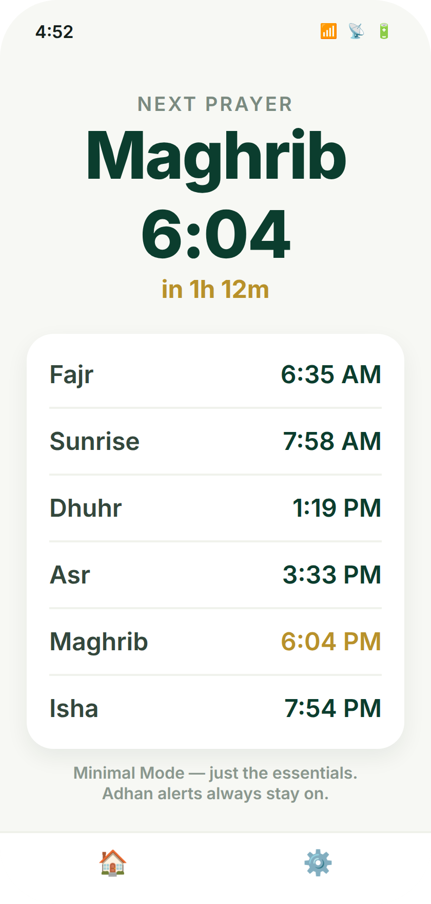
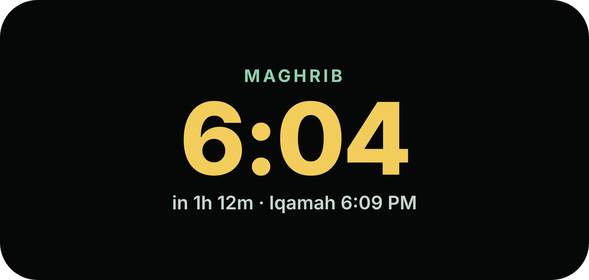
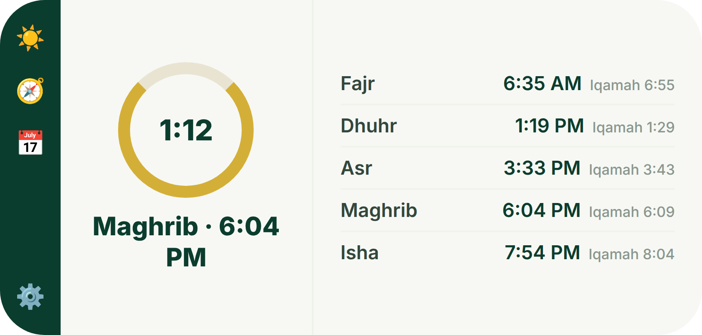

<p align="center">
  
</p>

<h1 align="center">Al Rashid Prayer</h1>

<p align="center">Prayer times for <b>AlRashid Mosque, Edmonton</b> | Home & Lock Screen widgets, a Live Activity, Apple Watch and Android, all calibrated to the mosque's own timetable.</p>

<p align="center">
  
  <a href="https://github.com/c12n/alrashid-widget/releases/latest"></a>
  <a href="https://github.com/c12n/alrashid-widget/releases"></a>
  
</p>

<p align="center">
  🕌 <a href="https://prayer.07051969.xyz"><b>Join the TestFlight beta</b></a> · 📥 <a href="https://github.com/c12n/alrashid-widget/releases/latest"><b>Download v2.0.0</b></a> · 🪶 <a href="https://raw.githubusercontent.com/c12n/alrashid-widget/main/altstore/source.json"><b>AltStore source</b></a> · 🐛 <a href="https://github.com/c12n/alrashid-widget/issues"><b>Report an issue</b></a>
</p>

`v2.0.0` · Our biggest update yet | colored widgets, Ramadan mode, a monthly calendar, Minimal Mode, and more.

> [!NOTE]
> **Unofficial.** Al Rashid Prayer is an independent companion app. It is not affiliated with or endorsed by AlRashid Mosque | it simply follows the mosque's published timetable (13070 113 St NW, Edmonton, Canada · [alrashidmosque.ca](https://alrashidmosque.ca)).

---

## 📱 Screenshots



|  |  |  |  |  |
| :---: | :---: | :---: | :---: | :---: |
| **Today** | **Colored widgets** | **Ramadan mode** | **Monthly calendar** | **Minimal Mode** |

|  |  |
| :---: | :---: |
| **StandBy** | **iPhone Duo** |

*Screenshots are design-faithful renders of the shipped 2.0.0 interface.*

---

## 🌟 Features

| **Widgets everywhere**<br>Home Screen (small, medium, large), Lock Screen, StandBy, Apple Watch with a complication, and Android home-screen widgets. On Fridays the Dhuhr row becomes **Jumu'ah** with the 1:30 PM khutbah time.<br> | **Colored widgets**<br>Match your app theme, or give the Home Screen, Lock Screen and Live Activity their own colors | 8 designed palettes. Find it in *Settings → Appearance → Widget Colors*.<br> |
| :--- | :--- |
| **Live countdowns**<br>The next prayer with a live countdown everywhere you look. Once the Adhan passes, the hero and the Live Activity flip to the **Iqamah countdown**, with an optional "time to leave" nudge.<br> | **Ramadan mode**<br>Automatic in Ramadan: Iftar and Suhoor hero countdowns, a Taraweeh slot after Isha, and widgets and the Live Activity that follow the month.<br> |
| **Monthly calendar**<br>The full month with Fajr and Maghrib on every day. Tap any day to preview its times, then share the month or print it.<br> | **Alerts your way**<br>An Adhan notification with sound at every prayer, per-prayer sounds and mutes, Sunnah fasting reminders (Mondays, Thursdays, the white days), and a **Jumu'ah Live Activity** on Fridays.<br> |
| **Silence in one tap**<br>Ask Siri, use the iOS 18 Control Center control, or tap the Android Quick Settings tile to silence just the next alert.<br> | **Minimal Mode**<br>Just the essentials | today's times, the next prayer, fasting times | with Adhan alerts always on. Turn it off and everything comes back exactly as it was. *Settings → Appearance*.<br> |
| **Big screens & the car**<br>A proper iPad split view, **iPhone Duo** (turn a big iPhone sideways for two panes), and an Android Auto prayer screen. CarPlay is ready in code but stays off | Apple limits which app categories may use it.<br> | **Yours to keep**<br>Back up your settings to a file, iCloud (iOS) or Google Drive (Android) and sync them between devices. No accounts, no ads, no analytics, no tracking | times are calculated on the device, so it works fully offline.<br> |

---

## 🚀 Installation

### iOS (iPhone and iPad)

**Option 1 | TestFlight (easiest)**

1. Open **[prayer.07051969.xyz](https://prayer.07051969.xyz)** on your iPhone or iPad.
2. Join the public beta and install **Al Rashid Prayer** from the TestFlight app.
3. Updates arrive through TestFlight automatically.

**Option 2 | AltStore, SideStore or Feather**

1. Add this source in AltStore, SideStore or Feather: `https://raw.githubusercontent.com/c12n/alrashid-widget/main/altstore/source.json`
2. Install **Al Rashid Prayer** from the source. It is a dedicated source with only this app in it.

**Option 3 | Manual sideload**

1. Download `AlRashidWidget-2.0.0.ipa` from the [latest release](https://github.com/c12n/alrashid-widget/releases/latest).
2. Install it with Sideloadly, AltServer, Xcode, or your preferred sideloading tool.

> [!TIP]
> The app and its widgets share data through an App Group, so re-signing with a free developer certificate is fine.

### Android

1. Download `AlRashidWidget-2.0.0.apk` from the [latest release](https://github.com/c12n/alrashid-widget/releases/latest) on your phone.
2. Open the APK. If Android asks, allow **installing from unknown sources** for your browser or Files app, then tap **Install**.
3. Open the app once, then long-press your home screen to add the prayer widgets.
4. For **Android Auto**: if the app does not appear on the car screen, turn on **Unknown sources** in Android Auto's developer settings.

---

## 📖 How to Use

1. **Open the app once** so the widgets load today's times.
2. **Add a widget:** long-press the Home Screen → **+** → search **Al Rashid**. For the Lock Screen, long-press it → **Customize**.
3. **Make it yours:** Settings → Appearance for themes, widget colors, per-prayer sounds | or flip on **Minimal Mode** for the essentials only.

---

## 🗺️ Roadmap

- **App Store release** | waiting on written permission from the mosque to use its name and timetable.
- **Google Drive backup sign-in** on Android (file backup already works).
- **CarPlay** | ready in code, waiting on Apple to allow the category.

---

## ⚠️ Known Issues

- On **Apple Watch**, the app keeps its own settings container, so the watch shows English/standard defaults | the prayer times themselves are correct.
- **Android Auto** may need the "Unknown sources" toggle in Android Auto's developer settings when the APK is sideloaded.
- The mosque publishes its timetable for **May to December**. January to April times come from the same calibrated calculation and may differ by a minute.

---

## ❓ FAQ

**Is it free?**
Yes | free, no ads, no in-app purchases.

**Where do the times come from?**
They're calculated on your device for the mosque's coordinates (53.591189, -113.515598, America/Edmonton) and calibrated against the mosque's published timetable, including its Iqamah offsets (Fajr +20, Dhuhr +10, Asr +10, Maghrib +5, Isha +10). The Hijri date uses the same Umm al-Qura calendar as the mosque's official app.

**Does it need the internet?**
No. Times, widgets and alerts all work offline. The only network use: while a Live Activity is running, the app sends that activity's push token and upcoming prayer times to the project's own small server so the activity can roll over at each Adhan | nothing is linked to an identity.

**Does it collect my data?**
No accounts, no analytics, no tracking, no ads. See the Privacy section below.

---

## 🔒 Privacy

Al Rashid Prayer does not collect analytics or usage data and shows no ads. Prayer times are calculated and stored on the device. The single exception above (Live Activity push token + prayer schedule to the project's own server) is covered by the app's bundled privacy manifest.

---

## 🏗️ Built With

- **iOS:** SwiftUI · WidgetKit · ActivityKit · App Intents | native Xcode project
- **Android:** Flutter port with the identical calculator and mosque calibration, validated to the minute against the iOS implementation

<details>
<summary><b>Build from source & technical notes</b></summary>

Requires Xcode 15+ (the GitHub Actions workflow uses the Xcode on `macos-26` runners).

```sh
xcodebuild \
  -project AlRashidWidget.xcodeproj \
  -scheme AlRashidWidget \
  -configuration Release \
  -destination 'generic/platform=iOS' \
  -archivePath build/AlRashidWidget.xcarchive \
  archive \
  CODE_SIGNING_ALLOWED=NO CODE_SIGNING_REQUIRED=NO CODE_SIGN_IDENTITY="" DEVELOPMENT_TEAM=""
```

Every push to `main` runs the **Build IPA** workflow, which archives the app unsigned (widget extension embedded in `PlugIns/`) and uploads `AlRashidWidget-IPA` as a build artifact.

**Project layout**

- `AlRashidWidget/` | the app target (app, assets, Info.plist, entitlements)
- `Shared/` | `PrayerCalculator.swift` (calculator with the mosque timetable calibration) and `PrayerModels.swift` (day model, Iqamah config, App Group cache, timeline planning, Umm al-Qura Hijri conversion), compiled into both targets
- `PrayerWidgetExtension/` | the WidgetKit extension
- `AlRashidWatch/` + `AlRashidWatchWidgets/` | the watchOS app and its complication
- `flutter/` | the Flutter edition (Android), with `android_overlay/` + `patch_android.py` applied by CI
- `make_icon.py` | regenerates the app icon set (Pillow)

**Calibration notes**

The calculator is fitted to the mosque's published May to December 2026 tables (Fajr 18.25°, Maghrib at sunset + 5 min, Asr Shafi with a +2 min adjustment, Isha as a calibrated interval after Maghrib, plus the mosque's summer schedule conventions): every prayer lands within about a minute on average. Widget timelines are planned at every prayer boundary plus midnight rollovers, and the Live Activity re-stages itself by a background refresh chained to just after each Adhan, with the push server as a second rollover path.

</details>

---

## Credits

Timetable and Iqamah schedule: **AlRashid Mosque** (published tables) · Hijri calendar: Umm al-Qura · Built and maintained by **c12n Apps**

## Disclaimer

This is an unofficial open-source project and is not affiliated with, authorized, or endorsed by AlRashid Mosque or Apple Inc. Provided "as is", without warranty of any kind. Prayer times are calculated in good faith against the mosque's published timetable; when in doubt, follow the mosque's own announcements.

- This app is **free**. If a third party charged you for it, you may have been misled.
- No user data is collected, stored, or distributed by this repository.

## 📄 License

MIT | Copyright (c) 2026 c12n Apps. See [LICENSE](LICENSE).

> [!TIP]
> **Star the repo** to get notified about new releases directly from GitHub.
